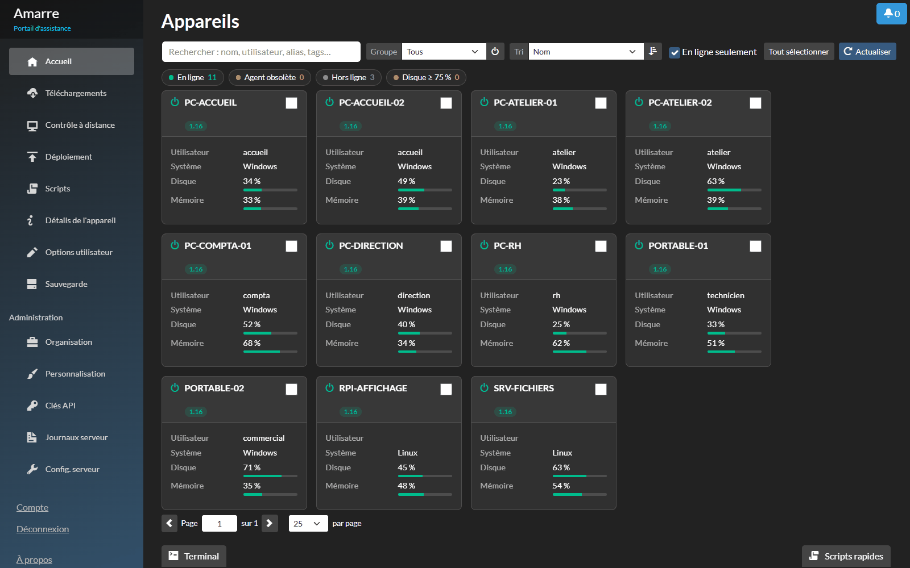
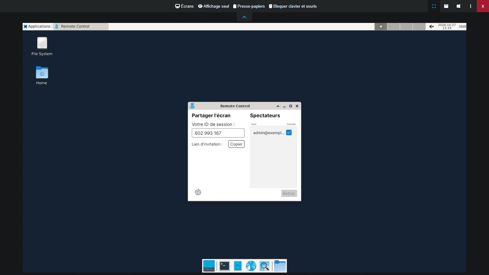
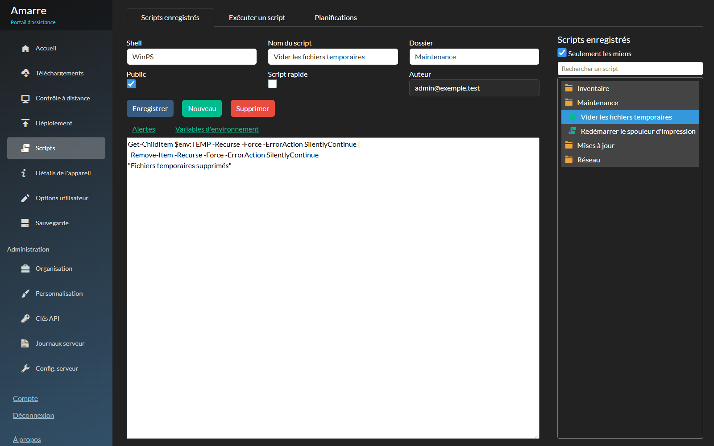

<div align="center">


# Amarre

**Prise en main et scripts à distance, auto-hébergés.**
Un fork maintenu de [Remotely](https://github.com/immense/Remotely), en français.

*Self-hosted remote control and remote scripting. A maintained fork of Remotely (French UI for now).*

[](https://github.com/jeremychn/amarre/actions/workflows/build.yml)
[](https://github.com/jeremychn/amarre/releases)
[](LICENSE)
[](https://dotnet.microsoft.com/)

</div>

---

Amarre reprend Remotely là où il s'est arrêté (code de décembre 2024) : passage à .NET 10, failles corrigées, bugs de production réglés et fonctions qui manquaient au quotidien du support. Il tourne en production tous les jours sur plusieurs centaines de postes.



## Pourquoi Amarre

- **L'utilisateur garde la main** : avec `EnforceAttendedAccess`, il doit accepter chaque prise en main. Sinon, il est au moins prévenu au début d'une session sans surveillance (`RemoteControlNotifyUser`).
- **Tout chez toi** : un conteneur Docker, une base SQLite ou PostgreSQL, aucun service tiers.
- **Maintenu et vérifié** : zéro avertissement de compilation, zéro paquet vulnérable connu, image analysée par Grype. La CI bloque toute publication qui ne passe pas.

## Ce qui change par rapport à Remotely

| | |
|---|---|
| **Plateforme** | .NET 10 LTS, toutes les dépendances à jour |
| **Prise en main** | Copier-coller dans les deux sens (Ctrl+C / Ctrl+V), claviers AZERTY (AltGr, pavé numérique), mode de qualité Auto / Performance / Qualité, schéma et miniatures en multi-écran |
| **Gestion des postes** | Bouton « Mettre à jour l'agent », version de l'agent affichée, témoin d'agent obsolète, compteurs cliquables (en ligne, agent obsolète, hors ligne, disque plein), actions groupées sur les postes cochés (réveiller, mettre à jour l'agent, changer de groupe, désinstaller, supprimer), sauvegarde et restauration JSON des appareils et des groupes |
| **Scripts** | Recherche de scripts et de postes dans les onglets |
| **Agents** | Windows x64/x86, Linux x64/ARM64 (Raspberry Pi), macOS x64/arm64, publiés automatiquement à chaque version |
| **Sécurité** | Voir [ci-dessous](#sécurité-par-rapport-à-remotely) |
| **Fiabilité** | Postes clonés (DeviceID en double) détectés par l'UUID matériel, fin des réinstallations d'agent en boucle, postes reconnectés qui ne sont plus marqués hors ligne à tort, base SQLite qui ne remplit plus le disque, réveil groupé (Wake-on-LAN) relayé par tous les postes en ligne du groupe, jeton du poste conservé aux mises à jour d'agent, journaux nettoyés |

Le détail version par version est dans [HISTORIQUE.md](HISTORIQUE.md).

## Sécurité par rapport à Remotely

Remotely n'est plus maintenu : ses failles ne seront pas corrigées. Amarre corrige notamment :

- **Contrôle à distance** : l'obligation d'être connecté s'applique au canal temps réel du viewer, plus seulement à la page.
- **Agents authentifiés** : chaque agent prouve qu'il détient le jeton de son poste, et vérifie de la même façon qu'il parle au bon serveur, sans que le jeton circule. Un poste ne peut plus se faire passer pour un autre, ni un faux serveur pour le vôtre.
- **Installeurs** : l'identifiant d'organisation d'un lien de téléchargement est vérifié avant d'être écrit dans le script d'installation.
- **API** : refus par défaut si une vérification d'autorisation échoue ; journaux du serveur et organisation par défaut réservés aux administrateurs du serveur ; les jetons temporaires remis aux agents ne donnent accès qu'aux données de leur organisation.
- **Viewer** : les messages et noms de fichiers venant du poste distant sont affichés comme du texte, plus interprétés comme du HTML.
- **Comptes** : seul un administrateur serveur peut réinitialiser, changer de rôle ou supprimer un autre administrateur serveur ; supprimer une invitation ne touche que sa propre organisation ; verrouillage contre la force brute.
- **E-mails** : les champs remontés par les postes sont encodés avant d'être insérés dans les e-mails HTML.
- **Serveur** : en-têtes HTTP défensifs, Swagger réservé au développement.
- **Dépendances** : SignalR (GHSA-f8h2-vmm9-qhj6), SQLitePCLRaw, MessagePack et les autres paquets à jour. Les contrôles tournent à chaque publication et chaque lundi, et l'image est analysée par Grype.

<table>
<tr>
<td width="50%"></td>
<td width="50%"></td>
</tr>
<tr>
<td align="center"><sub>Prise en main</sub></td>
<td align="center"><sub>Scripts à distance</sub></td>
</tr>
</table>

## Démarrage rapide

Il faut un serveur Linux avec Docker et un reverse proxy HTTPS (Caddy, Nginx Proxy Manager, BunkerWeb…). Le HTTPS est obligatoire : le copier-coller utilise l'API Clipboard du navigateur.

```yaml
# docker-compose.yml
services:
  amarre:
    image: ghcr.io/jeremychn/amarre:latest   # ou une version précise : amarre:X.Y
    container_name: remotely
    restart: unless-stopped
    ports:
      - "5000:5000"
    volumes:
      - /srv/remotely:/app/AppData
      - /srv/remotely/content:/app/wwwroot/Content
      - /srv/remotely/keys:/root/.aspnet/DataProtection-Keys
    environment:
      - ASPNETCORE_ENVIRONMENT=Production
      - ASPNETCORE_HTTP_PORTS=5000
      - TZ=Europe/Paris
      - Remotely_ApplicationOptions__DbProvider=SQLite
      - Remotely_ConnectionStrings__SQLite=Data Source=/app/AppData/Remotely.db
```

Avant le premier lancement, copie les scripts d'installation des agents dans le volume `content`, puis récupère les agents de la dernière release (il faut `python3` et `unzip` sur l'hôte) :

```bash
docker create --name tmp ghcr.io/jeremychn/amarre:latest
docker cp tmp:/app/wwwroot/Content/. /srv/remotely/content/ && docker rm tmp
curl -fsSL https://raw.githubusercontent.com/jeremychn/amarre/main/Utilities/maj-agents.sh | sudo sh
docker compose up -d
```

Ouvre ensuite ton URL HTTPS et clique sur **S'inscrire** : **le premier compte créé devient administrateur du serveur**, puis l'inscription se ferme.

Configuration complète, reverse proxy, mises à jour, retour arrière et dépannage : **[guide complet](docs/GUIDE.md)**.

## Mettre à jour

```bash
docker compose pull && docker compose up -d   # serveur
curl -fsSL https://raw.githubusercontent.com/jeremychn/amarre/main/Utilities/maj-agents.sh | sudo sh   # agents (les postes se mettent à jour seuls)
```

Les données, les clés et les agents sont sur l'hôte : revenir en arrière consiste à remettre l'image précédente.

## Langues

L'interface et la documentation sont en français pour l'instant. Une version multilingue (anglais par défaut, français et autres langues) est envisagée si le projet intéresse au-delà des francophones : dis-le dans une [issue](https://github.com/jeremychn/amarre/issues).

## Contribuer

Les issues et les pull requests sont bienvenues. Chaque PR passe la même CI que les versions publiées : compilation sans avertissement, aucun paquet vulnérable, tests, démarrage réel du serveur avec inscription et connexion, analyse de l'image.

Le projet est maintenu avec l'aide de l'IA (code, revues, audits de sécurité). Chaque modification est relue, compilée et testée avant d'être publiée.

Une faille de sécurité ? Ne l'ouvre pas en issue publique : voir [SECURITY.md](SECURITY.md).

## Crédits et licence

Amarre est basé sur [Remotely](https://github.com/immense/Remotely), créé par Jared Goodwin et © Immense Networks. Merci à eux pour ce travail.

Distribué sous licence **GNU GPL v3**, comme le projet d'origine : voir [LICENSE](LICENSE).
